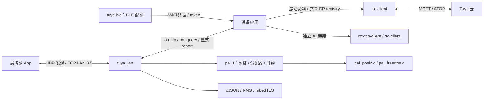
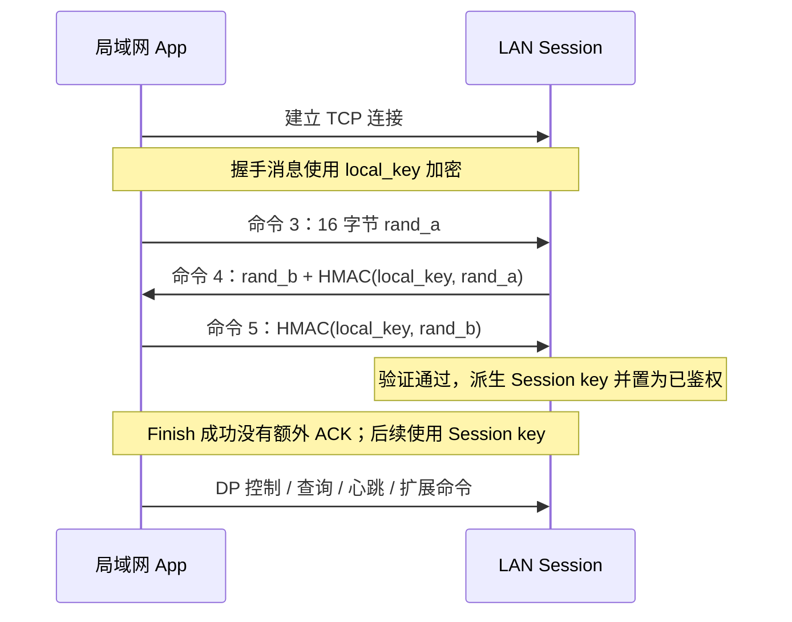
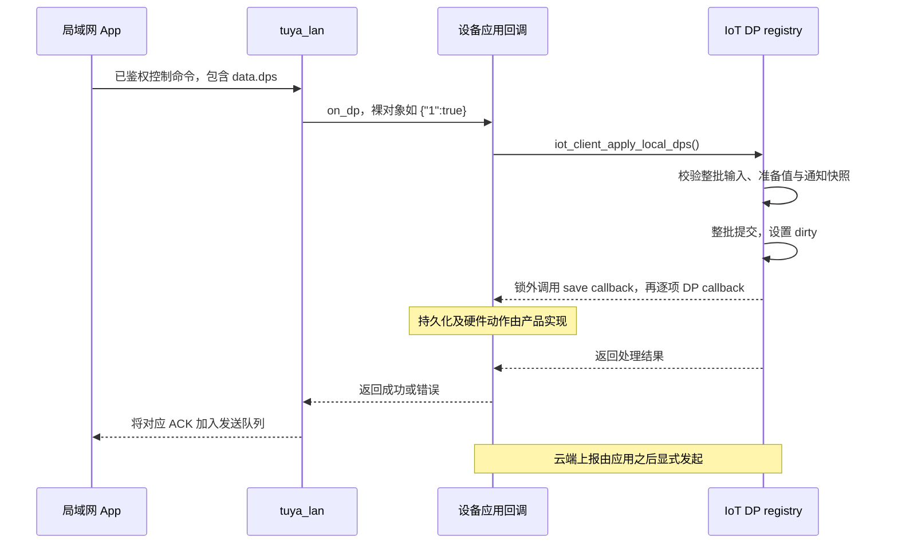

# Tuya LAN 架构与功能说明

`tuya_lan` 为已激活设备提供 Tuya LAN 3.5 本地控制服务。局域网 App 可以发现设备、建立鉴权会话、查询或下发 DP；设备应用可以向已鉴权会话显式上报状态。

本文说明当前实现的模块划分、数据流和运行约束。接口参数与接入代码见 [Tuya LAN 接口参考](../reference/tuya-lan.md)。协议参考基线与设计决策分别记录在 `modules/tuya-lan/CONTEXT.md` 和 `modules/tuya-lan/docs/adr/0001-lan-is-application-driven-and-shares-dp-state.md`。

## 一、架构与模块关系 {#architecture}



图中的应用负责组合各模块，箭头不表示它们共用所有回调线程。

- **`tuya-lan`**：管理 Discovery、TCP Session、鉴权、命令解析和发送队列；通过回调把业务请求交给应用。
- **`iot-client`**：提供已有激活流程和 DP registry。应用将 LAN 回调连接到公开 DP 接口，使 LAN 与 MQTT 使用同一份 schema 和 DP state。
- **`tuya-ble`**：当前负责 BLE 配网。LAN 使用激活后的设备资料，BLE 配网和 LAN 服务有各自的生命周期。
- **RTC/TAI 模块**：负责独立的 AI Connection/Session 或音视频能力。LAN Session 与 AI Foundation Session 的协议、密钥和生命周期不同。

`tuya_lan` 的构建目标链接 PAL、共享基础库和 cJSON，不链接 IoT、BLE 或 RTC 库。应用可以使用 IoT DP registry，也可以实现自己的 DP 回调；LAN 协议层无需了解产品业务。

### 内部职责划分 {#layers}

- **公共接口** `include/tuya_lan.h`：配置、生命周期、服务驱动、查询/控制回调、显式报告和扩展命令发送。
- **服务层** `src/tuya_lan.c`：TCP 监听、连接容量、UDP 发现调度、部分发送、发送队列及单会话故障回收。
- **协议层** `src/tuya_lan_protocol.c`：LAN 3.5 Frame、流式拆包、三步鉴权、Session key、序列校验和命令派发。其头文件属于模块私有接口。
- **平台能力** `pal/pal.h`：所有平台回调统一在 `pal_t` 中。LAN 使用可选监听、accept 和 UDP 回调；接受的 TCP 连接复用已有 `tcp_send/recv/poll/close`，收发传入 `timeout_ms=0`。实现分别位于 `pal/pal_posix.c`（BSD sockets）和 `pal/pal_freertos.c`（lwIP）。
- **共享能力**：同一份 `pal_t` 提供分配器和时钟，cJSON 处理 JSON，共享 RNG 与 mbedTLS 提供随机数和密码运算。`pal_is_valid()` 只要求基础回调，LAN 另用 `pal_has_server_network()` 检查完整的服务端/UDP 能力组。

## 二、已实现的功能 {#features}

- **设备发现**：发送 UDP 周期公告，响应经过校验的发现请求。
- **会话接入**：TCP 多连接、独立鉴权与密钥、握手/接收活跃超时、拆包和粘包处理。
- **本地控制**：处理 `0x07` / `0x0d` DP 控制，把裸 `dps` 对象交给 `on_dp`，根据回调结果回复成功或错误。
- **状态查询**：处理 `0x0a` / `0x10` 查询，通过 `on_query` 取得完整 `{"dps":{...}}` 文档后回复。
- **心跳回复**：已鉴权会话收到 `0x09` 后返回成功；设备不会自行创建心跳发送任务。
- **显式报告**：应用调用 `tuya_lan_report()`，向已鉴权会话发送 `0x08` 状态报告。
- **扩展命令**：其余已鉴权命令交给 `on_command`，应用通过 `tuya_lan_send()` 向指定 Session 回复。

设备的 `device_id`、`uuid`、`product_key` 与 `local_key` 来自已有设备资料。`local_key` 必须是恰好 16 字节的字符串；MQTT 的 `secret_key`、工厂 `auth_key` 和 AI session token 不能替代它。

## 三、Discovery 与鉴权 {#sessions}

### Discovery {#discovery}

默认 TCP 监听端口为 **6668**，UDP 接收端口为 **7000**，周期公告发往 **255.255.255.255:6667**。第一次 `tuya_lan_process()` 尝试公告，后续默认间隔为 5 秒。

公告携带设备标识、产品信息、IPv4 和协议版本。发现请求中的 IPv4 必须与实际 UDP 来源 IP 一致，响应发送到实际来源地址及端口。公开的 Discovery key 用于发现报文格式，控制权限由后续 `local_key` 鉴权建立。

`discovery_interval_ms = 0` 或 `broadcast_ip = NULL` 可以停止周期公告，发现请求响应仍然工作。设备 IPv4 改变后，应使用新配置重新创建服务，更新发现报文。

### 三步鉴权与 Session key {#authentication}

每个接受的 TCP 连接建立独立 Session。只有鉴权完成后才接受 DP、查询、心跳和扩展命令。



HMAC 使用 SHA-256。Session key 按当前 LAN 3.5 实现，由两端随机数与 `local_key` 派生；连接之间分别保存密钥、序列号、收包缓冲和发送队列。默认握手超时 10 秒，已鉴权后的接收活跃超时为 30 秒。任意通过认证及序列检查的入站命令都会刷新活跃时间，半帧数据不会刷新。

LAN 3.5 Frame 使用 AES-128-GCM，帧头参与附加认证数据校验。只有 GCM 验证通过后才提交入站序列号；序列号必须严格递增。鉴权失败、重放、乱序握手、异常帧长度、随机数失败或超时都会关闭对应 Session，其他 Session 继续工作。

## 四、DP 数据流与云端关系 {#dp-flow}

### 本地控制 {#local-control}

推荐使用公开的 `iot_client_apply_local_dps()` 接入现有产品逻辑，以下为成功路径：



批次失败时不修改 DP 值或 dirty 标记，也不发出该批次的回调。成功后先通知持久化回调，再依次调用 DP 回调，均在内部锁之外。成功 ACK 表示应用回调接受了请求；具体硬件执行过程由产品定义。

该入口与 MQTT 下行有不同的 dirty 语义：本地控制置 dirty，以便应用稍后向云端同步。应用根据产品权限决定是否接受请求；当前 DP 层没有强制执行 schema 的 ro/wr/rw access mode。

### 查询与两条上报通道 {#query-report}

`on_query` 写入完整 `{"dps":{...}}` 文档。应用可通过 `iot_dp_dump_json()` 获取共享快照；该接口按现有持久化规则省略 raw DP，需要包含 raw 状态时由应用构造文档。

状态通知有两个独立入口：

- **向局域网 App 通知**：应用构造 `{"dps":{...}}`，调用 `tuya_lan_report()`。协议层包装为包含 `protocol:4`、`t` 和 `data.dps` 的报告。
- **向云端同步**：应用在 IoT 所属线程调用 `iot_dp_report_all_dirty()` 等云上报接口。每次云端重连后仍应调用 `iot_dp_report_all()`，恢复前的数据没有持久化 dirty 标记。

LAN 查询、控制 ACK 和 LAN 报告均不会自动发起 MQTT 上报，也不清除云端 dirty 标记。LAN 服务本身不会在连接成功、控制成功或收到查询后额外推送状态。具备保存的凭据与有效 schema 时，本地控制可以在 MQTT 断开期间运行。

LAN 报告的 `t` 使用 `pal->wal_clock_time() / 1000` 的 UTC 秒数；当前路径在 UTC 返回 0 时会携带 `t=0`，应用应在发送报告前完成校时。握手和活跃超时使用单调 `time_ms()`，UTC 校正不影响这些期限。

## 五、线程、队列与返回值 {#execution}

所有 LAN API 和回调由同一个应用线程执行。`tuya_lan_process()` 不创建后台线程，调用一次进行以下工作：

1. 接受新连接，最多尝试 3 次；容量不足时关闭新接入连接。
2. 逐个检查 Session 超时，尝试刷新发送队列。
3. 每个连接最多读取 4 次，每次最多 1024 字节，处理完整 Frame 后再次尝试发送。
4. 根据周期发送发现公告，再最多处理 4 个 UDP 数据报。

每次发送队列刷新最多调用 4 次发送。这些预算限制 I/O 次数，单次 pump 耗时还取决于密码运算、JSON 解析和应用回调。应用需要频繁驱动服务。

**共享线程时的调度**：LAN 与 IoT 可以由同一应用线程串行驱动；MQTT 操作必须保持一个线程所有者。`iot_client_process()` 的 `timeout_ms` 参数不控制实际阻塞预算，即使传入 0，接收超时仍由 `AGENTIC_KIT_MQTT_RECV_TIMEOUT_MS` 决定。应结合该配置安排 LAN 调用频率。`rtc-tcp-client`（TAI）接收回调来自其工作线程，BLE 回调来自平台 BLE 上下文；从这些上下文触发 LAN 操作时，应交回 LAN 所属线程执行。

**回调重入**：`on_dp`、`on_query`、`on_command` 内允许调用 `tuya_lan_report()` 和 `tuya_lan_send()`。递归 `process()`、停止、断开全部连接和销毁都应等当前回调返回后执行。

### 队列和错误语义 {#backpressure}

每个 Session 有独立且有界的发送队列。部分写与 would-block 保留尚未发送的字节，后续 `process()` 继续刷新；队列溢出使对应 Session 失败并关闭。

- `report()` / `send()` 返回 `LAN_OK` 表示帧已排队，不能据此认定 socket 已发送完成或 App 已收到。后续发送需要继续 pump。
- `report()` 面向全部已鉴权会话，可能出现部分会话排队成功、部分失败；没有已鉴权会话时，有效报告仍可以返回 `LAN_OK`。
- 正常启动后的 `process()` 完成 pump 返回 `LAN_OK`。单会话网络或协议错误在内部关闭该会话，不从这个返回值逐一向外报告。
- `tuya_lan_client_count()` 统计仍有效的 TCP 连接，包含尚未鉴权的连接，不能作为已鉴权会话数使用。
- 控制回调错误和查询输出错误通常回复错误码 1 并保留会话。`on_command` 返回非 `LAN_OK` 则关闭会话；应用提供该回调时，需要通过 `send()` 自行回复扩展命令。

## 六、配置与资源预算 {#resources}

运行默认值由 `tuya_lan_config_init()` 填写：最多 **3 个连接**、握手 **10 秒**、接收活跃 **30 秒**、发现公告间隔 **5 秒**。连接数量可设为 1–3；TCP/UDP 监听端口可设为 0 申请临时端口，通过端口 getter 取得实际值，发现目的端口须为非零值。

编译期 `AGENTIC_KIT_LAN_MAX_FRAME_SIZE` 默认 **4096 字节**，支持 128–65536。它是整帧上限，JSON 或扩展数据还需预留 Frame、返回码及相应内层头的开销。`AGENTIC_KIT_LAN_LOG_LEVEL` 默认跟随 SDK 全局日志上限，只能进一步降低日志级别。

设最大帧长度为 `F`，每个接入 Session 的接收缓冲为 `F`，发送队列为 `2F`；服务另有两个 `F` 缓冲。默认 3 个连接均接入时，仅这些缓冲合计 **44 KiB**。结构体、JSON、密码运算临时内存和 socket 还需要额外空间，44 KiB 不是总内存峰值。

## 七、接入与生命周期 {#integration}

1. 在启动阶段调用一次 `iot_init()` 或 `iot_init_default()`，建立共享 PAL/RNG/cJSON 分配器绑定。`tuya_lan_config_init()` 只填写配置默认值。
2. 取得已激活设备的资料、当前 IPv4 和产品 schema，初始化应用使用的 DP registry。
3. 填写 `pal`、设备资料以及业务回调，调用 `tuya_lan_create()` 分配服务。`config.pal` 必须复用第 1 步初始化的同一份长期有效 PAL；各 SDK 模块共享 PAL/cJSON 分配器，不能为 LAN 另行绑定一套。此时还没有监听 socket。
4. 调用 `tuya_lan_start()` 打开 TCP/UDP，并在应用循环中调用 `tuya_lan_process()`。
5. 按产品策略显式进行 LAN 报告和云端上报。停止时先 `tuya_lan_stop()`，不再使用时 `tuya_lan_destroy()`。

`stop()` 后可重新 `start()`。配置采用浅拷贝：PAL、设备字符串及回调的 `user` 数据必须在使用期间保持有效。解绑、复位、换密钥、变更 IPv4 或释放凭据来源对象前，先停止并销毁 LAN，再用新配置重建。

### 编译开关 {#build-options}

LAN 默认关闭。主机通过 CMake 开启：

```bash
cmake -S . -B build -DAGENTIC_KIT_ENABLE_LAN=ON -DPython3_EXECUTABLE=$(which python3)
cmake --build build -j 4
```

ESP-IDF 在 **Agentic Kit** 菜单启用 LAN，对应 `CONFIG_AGENTIC_KIT_ENABLE_LAN=y`。构建系统向应用导出 `AGENTIC_KIT_ENABLE_LAN=0/1`，可用于条件编译。

关闭时移除 LAN 实现、LAN 测试和示例，并裁剪平台 PAL 中的可选服务端/UDP 实现，使相应回调为 NULL；通用 `iot_client_apply_local_dps()` 入口仍然可用。`pal_t` 的字段布局不随开关改变，新增字段后所有使用方须重新编译。自定义 PAL 仅在使用 LAN 时需要实现可选能力组。运行期 `start()` / `stop()` 则控制已编译服务的监听状态。

完整配置、回调示例与 POSIX `lan_demo` 的启动方式见 [接口参考](../reference/tuya-lan.md#build)。

## 八、能力边界与验证 {#limits-validation}

当前提供 LAN 3.5 Discovery、鉴权和本地 DP 服务。旧版 LAN 与 AP 配网属于其他能力。

`TUYA_LAN_CMD_P2P = 0x20` 可以作为已鉴权的扩展命令交给应用。它提供信令承载入口；当前模块没有实现 P2P 协商状态机、NAT 穿透、媒体传输或 RTC 桥接。这些功能需要应用接入其他实现，AI session token 也不用于 LAN 鉴权。

现有验证分为以下几层：

- `test_protocol.c`：鉴权、Session key、Frame 校验、序列和重放、JSON 以及密码运算失败路径。
- `test_service.c`：生命周期、连接隔离、发现调度、部分发送和背压。
- `test_peer.py`：独立加密 peer 通过真实回环 socket 验证协议与共享 DP registry。
- `pal/test/test_net.c`：同一组回环网络用例覆盖 POSIX 与真实 FreeRTOS PAL 源码（主机内核声明 shim），验证监听、UDP、连接/接受共用 TCP 接口、零/正超时和资源回收。
- `iot_dp_test.c`：本地 DP 批次原子性、分配失败回滚、回调生命周期以及 UTC/空上报回归。

```bash
ctest --test-dir build -R '^(tuya_lan_.*|pal_net_test|pal_freertos_net_test|iot_dp_test)$' --output-on-failure --no-tests=error
```

测试保持串行。自动化用例无需云端凭据；真实 App 互通、目标硬件及无线网络行为仍需在产品环境验证。
