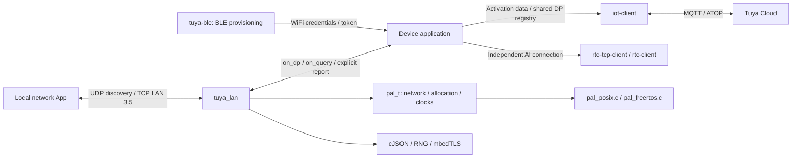
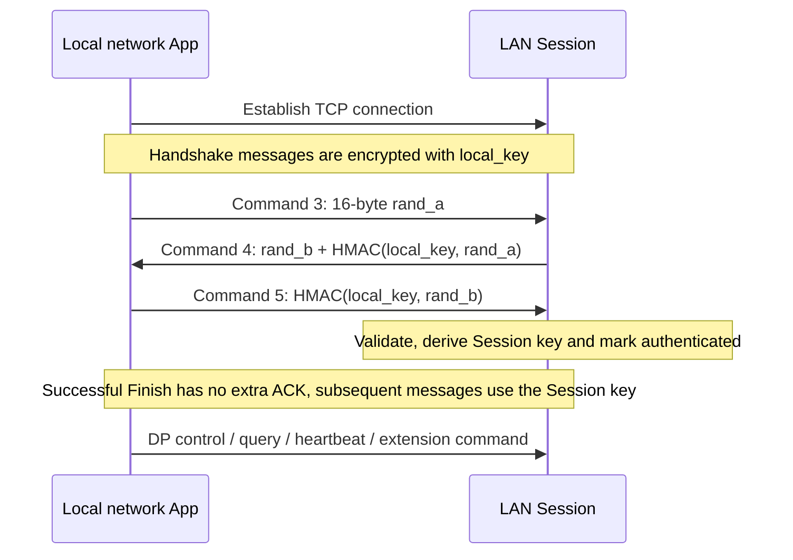
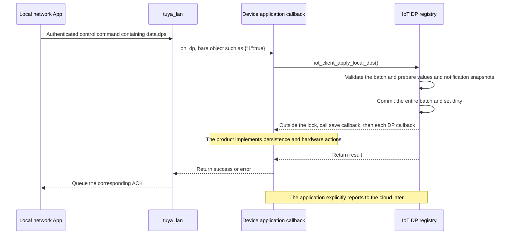

# Tuya LAN Architecture and Features

`tuya_lan` provides a Tuya LAN 3.5 local control service for activated devices. An App on the local network can discover a device, establish an authenticated Session, and query or control DPs. The device application can explicitly report state to authenticated Sessions.

This guide describes the current implementation's modules, data flow and execution constraints. For API parameters and integration code, see the [Tuya LAN API Reference](../reference/tuya-lan.md). The protocol reference baseline and design decisions are recorded in `modules/tuya-lan/CONTEXT.md` and `modules/tuya-lan/docs/adr/0001-lan-is-application-driven-and-shares-dp-state.md`.

## 1. Architecture and Module Relationships {#architecture}



The application composes these modules. The arrows do not imply that all callbacks share a thread.

- **`tuya-lan`** manages Discovery, TCP Sessions, authentication, command parsing and send queues. It passes business requests to the application through callbacks.
- **`iot-client`** provides the existing Activation flow and DP registry. The application connects LAN callbacks to public DP APIs so that LAN and MQTT use the same schema and DP state.
- **`tuya-ble`** currently handles BLE provisioning. LAN uses the device's Activation data; BLE provisioning and the LAN service have separate lifecycles.
- **RTC/TAI modules** provide independent AI Connection/Session or audio/video capabilities. A LAN Session and an AI Foundation Session have different protocols, keys and lifecycles.

The `tuya_lan` build target links the PAL, shared infrastructure library and cJSON. It does not link the IoT, BLE or RTC libraries. Applications can use the IoT DP registry or implement their own DP callbacks; the LAN protocol layer does not need to understand product behavior.

### Internal Responsibilities {#layers}

- **Public API**, `include/tuya_lan.h`: configuration, lifecycle, service pumping, query/control callbacks, explicit reports and extension command sending.
- **Service layer**, `src/tuya_lan.c`: TCP listening, connection capacity, UDP discovery scheduling, partial sends, send queues and cleanup of individual failed Sessions.
- **Protocol layer**, `src/tuya_lan_protocol.c`: LAN 3.5 Frames, stream framing, three-step authentication, Session keys, sequence validation and command dispatch. Its header is private to the module.
- **Platform capabilities**, `pal/pal.h`: all platform callbacks share `pal_t`. LAN uses optional listening, accept and UDP callbacks. Accepted TCP connections reuse the existing `tcp_send/recv/poll/close` callbacks with `timeout_ms=0` for sends and receives. Implementations live in `pal/pal_posix.c` (BSD sockets) and `pal/pal_freertos.c` (lwIP).
- **Shared capabilities**: the same `pal_t` supplies allocation and clocks, cJSON handles JSON, and the shared RNG and mbedTLS provide randomness and cryptographic operations. `pal_is_valid()` requires only base callbacks; LAN checks its complete server/datagram group with `pal_has_server_network()`.

## 2. Implemented Features {#features}

- **Device discovery**: periodic UDP announcements and responses to validated discovery requests.
- **Session handling**: multiple TCP connections, independent authentication and keys, handshake/receive-activity deadlines, and handling of fragmented or coalesced Frames.
- **Local control**: commands `0x07` / `0x0d` pass a bare `dps` object to `on_dp`, then return success or an error according to the callback result.
- **State queries**: commands `0x0a` / `0x10` use `on_query` to obtain a complete `{"dps":{...}}` document for the response.
- **Heartbeat replies**: authenticated Sessions receive a success response to `0x09`. The device does not create a heartbeat sending task.
- **Explicit reports**: the application calls `tuya_lan_report()` to send a `0x08` state report to authenticated Sessions.
- **Extension commands**: other authenticated commands reach `on_command`. The application uses `tuya_lan_send()` to reply to a specified Session.

The device's `device_id`, `uuid`, `product_key` and `local_key` come from its existing device data. `local_key` must be a string containing exactly 16 bytes. The MQTT `secret_key`, factory `auth_key` and AI session token cannot replace it.

## 3. Discovery and Authentication {#sessions}

### Discovery {#discovery}

The default TCP listening port is **6668**, the UDP receive port is **7000**, and periodic announcements go to **255.255.255.255:6667**. The first `tuya_lan_process()` attempts an announcement; the default interval thereafter is five seconds.

Announcements carry device identity, product information, IPv4 and protocol version. The IPv4 address in a discovery request must match its actual UDP source IP. Responses go to the actual source address and port. The public Discovery key is used for the discovery message format; subsequent `local_key` authentication establishes control authorization.

Setting `discovery_interval_ms = 0` or `broadcast_ip = NULL` disables periodic announcements while discovery request responses remain available. Recreate the service with new configuration after the device's IPv4 address changes so discovery messages carry the new address.

### Three-Step Authentication and Session Keys {#authentication}

Each accepted TCP connection creates an independent Session. DP, query, heartbeat and extension commands are accepted only after authentication completes.



HMAC uses SHA-256. The current LAN 3.5 implementation derives the Session key from both peers' random values and `local_key`. Each connection retains its own key, sequence counters, receive buffer and send queue. The default handshake deadline is 10 seconds; after authentication, the receive-activity deadline is 30 seconds. Any incoming command that passes authentication and sequence validation refreshes activity. Partial Frame data does not refresh it.

LAN 3.5 Frames use AES-128-GCM with the header as authenticated additional data. Incoming sequence counters are committed only after GCM authentication succeeds; sequence numbers must strictly increase. Authentication failure, replay, out-of-order handshake messages, invalid Frame lengths, randomness failure or timeout close the affected Session while other Sessions continue working.

## 4. DP Data Flow and the Cloud {#dp-flow}

### Local Control {#local-control}

Use the public `iot_client_apply_local_dps()` API to connect LAN control to existing product behavior. The following diagram shows the success path:



A failed batch leaves DP values and dirty flags unchanged and invokes none of that batch's callbacks. After success, the persistence callback runs first, followed by each DP callback, all outside the internal lock. A success ACK means the application callback accepted the request; the product defines how hardware execution proceeds.

This entry point has different dirty semantics from MQTT downlinks: local controls set dirty so the application can synchronize with the cloud later. The application decides whether product permissions allow a request. The DP layer currently does not enforce the schema's ro/wr/rw access mode.

### Queries and the Two Reporting Channels {#query-report}

`on_query` writes a complete `{"dps":{...}}` document. The application can obtain a shared snapshot through `iot_dp_dump_json()`. This API follows the existing persistence rules and omits raw DPs; construct the document in the application when raw state must be included.

State notifications have two independent entry points:

- **Notify the local network App**: the application constructs `{"dps":{...}}` and calls `tuya_lan_report()`. The protocol layer wraps it in a report containing `protocol:4`, `t` and `data.dps`.
- **Synchronize with the cloud**: the application calls a cloud reporting API such as `iot_dp_report_all_dirty()` on the IoT owner thread. It should still call `iot_dp_report_all()` after every cloud reconnect because restored data does not retain persisted dirty flags.

LAN queries, control ACKs and LAN reports neither initiate MQTT reporting nor clear cloud dirty flags. The LAN service does not push additional state after a connection succeeds, a control succeeds or a query arrives. Local control can operate while MQTT is disconnected when saved credentials and a valid schema are available.

The `t` field in a LAN report uses UTC seconds from `pal->wal_clock_time() / 1000`. This path currently sends `t=0` when UTC returns zero, so the application should synchronize time before reporting. Handshake and activity deadlines use monotonic `time_ms()`; UTC corrections do not affect these deadlines.

## 5. Threads, Queues and Return Values {#execution}

All LAN APIs and callbacks execute on one application thread. `tuya_lan_process()` creates no worker. Each call performs the following work:

1. Accept new connections, with at most three attempts; close new connections when capacity is exhausted.
2. Check each Session's deadline and try to flush its send queue.
3. Read each connection at most four times, up to 1024 bytes per read, then try sending again after processing complete Frames.
4. Send a discovery announcement when due, then process at most four UDP datagrams.

Each send-queue flush makes at most four send calls. These budgets limit I/O attempts; pump duration also depends on cryptographic operations, JSON parsing and application callbacks. The application must pump the service frequently.

**Scheduling on a shared thread**: LAN and IoT can run serially on the same application thread; MQTT operations must retain a single thread owner. The `timeout_ms` argument to `iot_client_process()` does not control its actual blocking budget. Even when it is zero, `AGENTIC_KIT_MQTT_RECV_TIMEOUT_MS` determines the receive timeout. Account for this configuration when scheduling LAN calls. Receive callbacks in `rtc-tcp-client` (TAI) run on its worker thread, while BLE callbacks run in the platform BLE context. Hand LAN operations triggered from those contexts back to the LAN owner thread.

**Callback reentrancy**: `on_dp`, `on_query` and `on_command` may call `tuya_lan_report()` and `tuya_lan_send()`. Defer recursive `process()`, stop, disconnect-all and destroy operations until the current callback returns.

### Queues and Error Semantics {#backpressure}

Each Session has its own bounded send queue. Partial writes and would-block results retain unsent bytes for subsequent `process()` calls. Queue overflow fails and closes the affected Session.

- `LAN_OK` from `report()` / `send()` means the Frame was queued. It does not establish that the socket finished sending or the App received it. Continue pumping to send queued data.
- `report()` targets all authenticated Sessions. Some Sessions may accept the queued report while others fail. A valid report may return `LAN_OK` when there are no authenticated Sessions.
- After a normal start, `process()` returns `LAN_OK` when the pump completes. Network or protocol failures in an individual Session close it internally rather than being reported individually through this return value.
- `tuya_lan_client_count()` counts valid TCP connections, including connections that are not yet authenticated. It is not an authenticated Session count.
- Control callback errors and query output errors normally produce error code 1 and keep the Session open. A non-`LAN_OK` result from `on_command` closes the Session. When the application supplies this callback, it must reply to extension commands through `send()`.

## 6. Configuration and Resource Budget {#resources}

`tuya_lan_config_init()` fills the runtime defaults: at most **three connections**, a **10-second** handshake deadline, a **30-second** receive-activity deadline and **five-second** discovery announcements. The connection limit can be set from 1 to 3. TCP/UDP listening ports can be zero to request ephemeral ports; port getters return the actual values. The discovery destination port must be nonzero.

The compile-time `AGENTIC_KIT_LAN_MAX_FRAME_SIZE` defaults to **4096 bytes** and supports 128–65536. It limits the entire Frame; JSON or extension data must leave space for Frame overhead, the return code and any relevant inner header. `AGENTIC_KIT_LAN_LOG_LEVEL` follows the SDK's global log ceiling by default and can only lower it further.

For a maximum Frame size of `F`, each accepted Session has an `F` receive buffer and a `2F` send queue. The service has two additional `F` buffers. With the default three connections all accepted, these buffers alone total **44 KiB**. Structures, JSON, cryptographic temporary allocations and sockets require additional memory; 44 KiB is not the total peak memory requirement.

## 7. Integration and Lifecycle {#integration}

1. Call `iot_init()` or `iot_init_default()` once at startup to bind the shared PAL/RNG/cJSON allocator. `tuya_lan_config_init()` only fills configuration defaults.
2. Obtain the activated device's data, current IPv4 address and product schema, and initialize the application's DP registry.
3. Set `pal`, device data and business callbacks, then call `tuya_lan_create()` to allocate the service. `config.pal` must reuse the same long-lived PAL initialized in step 1. SDK modules share the PAL/cJSON allocator; do not bind a separate allocator for LAN. No socket is listening yet.
4. Call `tuya_lan_start()` to open TCP/UDP and call `tuya_lan_process()` from the application loop.
5. Explicitly report through LAN and to the cloud according to product policy. Call `tuya_lan_stop()` to stop the service and `tuya_lan_destroy()` when it is no longer needed.

A stopped service can be started again. Configuration is shallow-copied: the PAL, device strings and callback `user` data must remain valid while in use. Before unbinding, resetting, changing keys or IPv4, or releasing the object that owns the credentials, stop and destroy LAN, then recreate it with the new configuration.

### Build Options {#build-options}

LAN is disabled by default. Enable it with host CMake:

```bash
cmake -S . -B build -DAGENTIC_KIT_ENABLE_LAN=ON -DPython3_EXECUTABLE=$(which python3)
cmake --build build -j 4
```

For ESP-IDF, enable LAN in the **Agentic Kit** menu, corresponding to `CONFIG_AGENTIC_KIT_ENABLE_LAN=y`. The build exports `AGENTIC_KIT_ENABLE_LAN=0/1` to application code for conditional compilation.

Disabled builds omit the LAN implementation, LAN tests and example. Optional server/UDP code inside the platform PALs is excluded and those callbacks are NULL. The general `iot_client_apply_local_dps()` entry point remains available. The `pal_t` field layout is independent of the option; all consumers must rebuild after new fields are added. Custom PALs need the optional group only for LAN. Runtime `start()` / `stop()` controls the listening state of a compiled service.

See the [API Reference](../reference/tuya-lan.md#build) for complete configuration, callback examples and instructions for running the POSIX `lan_demo`.

## 8. Capability Boundaries and Validation {#limits-validation}

The current implementation provides LAN 3.5 Discovery, authentication and local DP services. Legacy LAN versions and AP provisioning are separate capabilities.

`TUYA_LAN_CMD_P2P = 0x20` can reach the application as an authenticated extension command. It provides a signaling entry point. This module does not implement a P2P negotiation state machine, NAT traversal, media transport or an RTC bridge. Applications must connect other implementations for those features. AI session tokens are not used for LAN authentication.

Existing validation has the following layers:

- `test_protocol.c`: authentication, Session keys, Frame validation, sequence/replay handling, JSON and cryptographic failure paths.
- `test_service.c`: lifecycle, connection isolation, discovery scheduling, partial sends and backpressure.
- `test_peer.py`: an independent encrypted peer validates the protocol and shared DP registry through real loopback sockets.
- `pal/test/test_net.c`: the same loopback cases exercise POSIX and the actual FreeRTOS PAL source (with host kernel declaration shims), covering listening, UDP, shared connected/accepted TCP operations, zero/positive timeouts and resource cleanup.
- `iot_dp_test.c`: local DP batch atomicity, rollback on allocation failure, callback lifecycle, and UTC/empty-report regressions.

```bash
ctest --test-dir build -R '^(tuya_lan_.*|pal_net_test|pal_freertos_net_test|iot_dp_test)$' --output-on-failure --no-tests=error
```

Keep tests serial. Automated cases require no cloud credentials. Interoperability with a real App, target hardware and wireless network behavior still require validation in the product environment.
